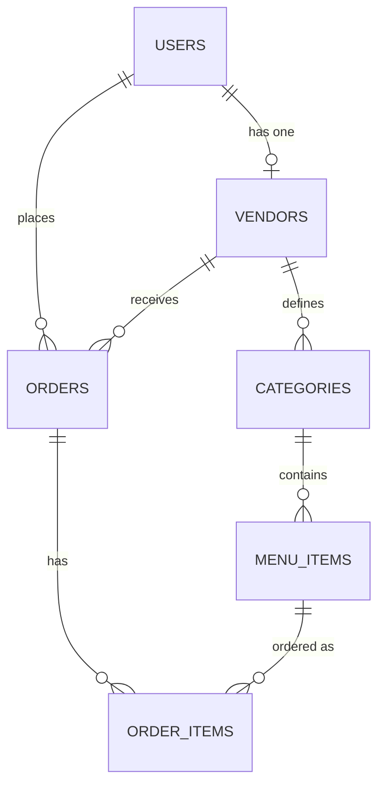

# QuickBite — Modern Campus Food Ordering & Vendor Management Platform

[](https://laravel.com)
[](https://react.dev)
[](https://inertiajs.com)
[](https://tailwindcss.com)

**QuickBite** is a premium, full-stack campus food ordering and vendor management system built to streamline food discovery, ordering, and vendor operations on campus. By connecting students directly with local campus food vendors, it minimizes wait times, offers visual food browsing, and provides vendors with real-time order tracking and shop analytics.

---

## 🚀 Key Features

### 👨‍🎓 For Students
- **Premium Landing Page:** A modern, venture-backed-style landing page featuring visual menus, popular food showcases, top vendors, and student testimonials.
- **Visual Food Discovery:** Browse 10+ campus vendors and filter their specific menus by categories.
- **Spacious Horizontal Menu Layout:** Clean, uncluttered menu list displaying detailed food items with description, price, preparation time, and high-quality matched food photos.
- **Smart Shopping Cart:** Add items from a selected vendor, adjust quantities, and see total prices in real-time.
- **Role-Based Cart Flow:** Seamlessly redirects unauthenticated users to the registration/sign-up page when interacting with the checkout or "Become a Vendor" flows.
- **Order Tracking:** Track orders through different statuses (`Pending` ➔ `Preparing` ➔ `Ready` ➔ `Completed`) on the student dashboard.

### 🏪 For Food Vendors
- **Vendor Setup:** Create a vendor shop with a custom name and description.
- **Vendor Dashboard & Analytics:** Real-time analytics displaying **Total Revenue** and **Active Orders** at a glance.
- **Menu Management:** Add, edit, or delete food categories and specific menu items (complete with description, pricing, preparation time, and image uploads).
- **Order Status Control:** Update student orders in real-time to alert them when their food is preparing, ready for pickup, or completed.

---

## 🛠️ Tech Stack & Architecture

- **Backend:** Laravel 11.x (PHP 8.5+)
- **Frontend SPA:** React 18.x (served as a Single Page Application via Inertia.js)
- **Styling:** Tailwind CSS 4.0 & Custom Vanilla CSS (with Glassmorphism and micro-animations)
- **Database:** MySQL
- **Assets & Icons:** Lucide React, Headless UI, Unsplash API (for high-quality, pre-matched seeded photos)

### Architectural Overview
QuickBite uses a **monolithic SPA architecture** enabled by **Inertia.js**. Instead of building a separate API and frontend repository, Laravel acts as the routing engine, controller layer, and database provider, serving React components directly. This eliminates the need for manual API state synchronizations (such as Redux or REST state boilerplate) and provides a fast, smooth user experience.

---

## 📊 Database Schema

The database consists of 6 primary tables representing the core entities of the project:



1. **`users`:** Stores authentication details, names, emails, and roles (`student`, `vendor`, `admin`).
2. **`vendors`:** Stores vendor shop profiles linked to a user account, including shop name, description, logo, and active/open status.
3. **`categories`:** Organizes menu items under a vendor (e.g., "Rice Dishes", "Drinks", "Grills").
4. **`menu_items`:** Individual food items containing name, description, price, image URL, availability status, and preparation time.
5. **`orders`:** Tracks individual order records linking a student and vendor, containing the total amount, status, and timestamps.
6. **`order_items`:** Junction table linking ordered menu items to their parent order, tracking quantities and snapshot prices at the time of purchase.

---

## 💻 Setup & Installation Guide

To run this project locally, follow these steps:

### Prerequisites
- **XAMPP / WampServer** (with PHP 8.2+ and MySQL enabled)
- **Composer** (PHP dependency manager)
- **Node.js & npm** (version 18+ recommended)
- **Git**

### Step-by-Step Setup

1. **Clone the Repository:**
   ```bash
   git clone https://github.com/aishazakari422-ops/Quickbite.git
   cd Quickbite
   ```

2. **Install Composer Dependencies:**
   ```bash
   composer install
   ```

3. **Install NPM Dependencies:**
   ```bash
   npm install
   ```

4. **Environment Configuration:**
   Copy the example environment file and generate the application key:
   ```bash
   copy .env.example .env
   php artisan key:generate
   ```

5. **Configure Database Connection:**
   Open the `.env` file and set your local database credentials (usually MySQL):
   ```env
   DB_CONNECTION=mysql
   DB_HOST=127.0.0.1
   DB_PORT=3306
   DB_DATABASE=quickbite
   DB_USERNAME=root
   DB_PASSWORD=
   ```

6. **Create Database & Run Seeders:**
   Ensure MySQL is running (e.g., in XAMPP). Create a database named `quickbite` in phpMyAdmin or via terminal:
   ```bash
   # If you have mysql in your PATH:
   mysql -u root -e "CREATE DATABASE quickbite CHARACTER SET utf8mb4 COLLATE utf8mb4_unicode_ci;"
   ```
   Run all migrations and seed the database with the default 10 vendors and 46 food items:
   ```bash
   php artisan migrate --seed
   ```

7. **Run Development Servers:**
   Open two terminals to run the Laravel backend server and Vite frontend compiler:

   *Terminal 1 (Laravel Server):*
   ```bash
   php artisan serve
   ```

   *Terminal 2 (Vite Compiler):*
   ```bash
   npm run dev
   ```

   Open your browser and navigate to **`http://localhost:8000`** to view the live site.

---

## 🔑 Pre-seeded Test Accounts

To easily test all user flows, you can log in using the pre-seeded accounts:

### Student Account (Customer Flow)
- **Email:** `student@quickbite.com`
- **Password:** `password`

### Vendor Accounts (Management & Dashboard Flow)
Here are some of the 10 available pre-seeded vendors. All share the password `password`:
- **Mama Titi's Kitchen:** `mamatiti@quickbite.com` (Rice Dishes, Soups & Swallow)
- **Burger Boss:** `burgerboss@quickbite.com` (Handcrafted Burgers & Sides)
- **Pizza Palace:** `pizzapalace@quickbite.com` (Wood-fired style pizzas)
- **Suya Spot:** `suyaspot@quickbite.com` (Northern-style suya grills & Zobo)
- **The Smoothie Bar:** `smoothiebar@quickbite.com` (Healthy smoothies & juices)

---

## 🤝 Project Link & Review
You can share the GitHub repository with your lecturer:
🔗 **GitHub Repository:** [https://github.com/aishazakari422-ops/Quickbite](https://github.com/aishazakari422-ops/Quickbite)
